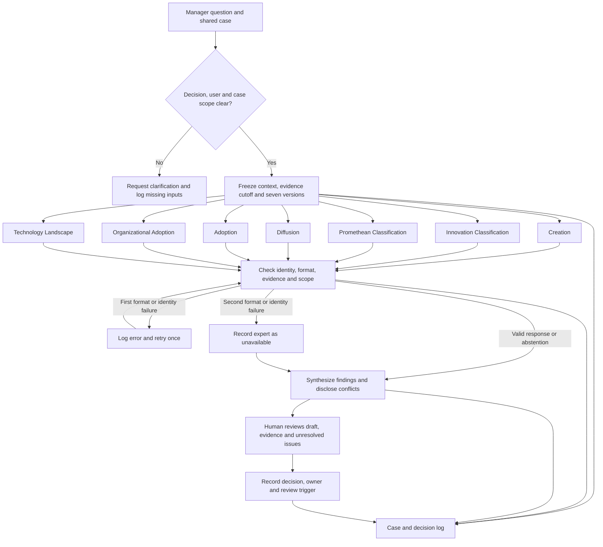

# Workshop 10 · Final Mixture-of-Experts Architecture and Orchestration Package

Milk-Almond · Workshop decision draft v0.1

The proposed system gives a manager one reviewable answer to a specific question about an emerging technology in their organization. All seven specialists see the same evidence and work independently. A synthesizer drafts a recommendation, and a named human reviewer records the decision. Lab 11 will test this routing choice across the three planned cases. The robotics case below is a worked example. Lab 1 identifies senior decision-makers as the primary users. Each case should identify the person authorized to make the specific decision.

## Step 1 · Confirm the decision and inventory the experts (0–10 minutes)

The team’s Lab 1 Management Need Brief names senior decision-makers as the primary users. Finance, operations, IT, risk and compliance, project managers, business units and end users contribute evidence. Management needs to decide whether, when and how to act: monitor, experiment, adopt, defer or reject. The decision turns on the actual organizational need, strategic and application fit, risk, timing, resources and readiness.

For the Lab 9 stockroom example, a senior decision-maker receives the recommendation and facilities operations supplies the workflow evidence. The immediate question is whether to prepare a feasibility comparison. Authorization to begin physical testing is a separate decision requiring institutional approvals. Record the case-specific decision owner and confirm the Lab 2 shared intake and output contracts.

| Expert and pinned version | What the specialist contributes | Boundary or open issue from Lab 9 |
|---|---|---|
| Creation · team-1.0.0 | Traces how the capability developed and what it depends on | Confirm final post-test acceptance and the Team-Lab3-Final directory before release. |
| Innovation Classification · lab4-team-approved-v1.0 | Separates invention, commercialization and novelty to this organization | The saved primary response identifies an older candidate. Verify metadata on a fresh response. |
| Promethean Classification · 0.1.3-team | Assesses magnitude, reach and uncertainty | Use the approved retest record. Its narrow LLM dossier cannot settle the significance of robotics. |
| Diffusion · 1.0-team-synthesis | Assesses spread within a defined adopter population | Keep the proposed v1.1 separate. A few deployments cannot establish market penetration. |
| Adoption · 1.2-team-review | Proposes a bounded action and conditions for changing it | Preserve the distinction between monitoring a trend and deferring a specific decision. |
| Organizational Adoption · team-subagent-6-v1.0.0 | Assesses readiness, ownership, resources and controls | Check the corrected distinction between an unknown and a confirmed blocker. Fresh retest remains open. |
| Technology Landscape · lab09-landscape-v1.0.0-rc1 | Compares alternatives, dependencies and dated signals | Check evidence cutoff and applicability for each case. A proposed comparison conveys no approval. |

Use the [Lab 9 integration audit](https://github.com/Milk-Almond/Team-Assignment9/blob/main/records/integration-audit.md) for Agent Records, saved tests and open issues. The [seven-agent roster](https://github.com/Milk-Almond/Team-Assignment9/blob/main/integration/nyu_humanoid/roster.json) identifies the repository, directory and commit for each version.

## Step 2 · Choose how a case moves through the system (10–24 minutes)

For Lab 11, invoke all seven specialists on each complete case using the same evidence. Each specialist may abstain when the evidence is insufficient. This reuses the existing Lab 9 packet design and gives the team an explicit record when a specialist lacks evidence. Conditional routing would require someone to predict which expertise matters before seeing the findings. After the three planned cases, review which findings affected each recommendation and whether any specialist should run only under specific conditions.

1. **Prepare one shared input.** Use the 11 required fields in the frozen intake: technology, intended application, organization, industry sector, business need, stakeholders, adoption posture, capabilities and constraints, risk context, management question and time horizon. Attach the dated evidence register and record the case ID, revision and evidence cutoff. If the decision or organization is ambiguous, clarify it before routing. If a fact such as available budget is unknown, label it unknown and proceed.
2. **Issue seven independent prompts.** Give each expert the same case, sources, common instructions and output format, together with its own pinned instructions and identity. The experts can run in any order in separate fresh chats. Even the Adoption expert gives its own bounded assessment before seeing the other six. If the decision scope changes, issue a new shared case revision.
3. **Collect and check each response.** Save the raw JSON. Check the returned identity and version, then the general, application and organizational findings, cited evidence, limitations, confidence, value and risk implications, management implication, triggers and evidence requests. Record the case revision, specialist version, attempt, raw output reference, status and reason in a separate run log.
4. **Account for every expert before synthesis.** Each of the seven slots must have a checked response, a recorded abstention, or an unavailable status after the retry rule in Step 3. The synthesizer can then show which findings support the draft and which unanswered questions still matter.

**Example for the team discussion.** For the NYU stockroom case, Diffusion may have evidence of industrial use but too little evidence to estimate spread in universities. It can return that limitation. Organizational Adoption can still identify which campus permissions are unknown, and Landscape can identify the cart comparison. These independent contributions let management consider planning a comparison while deferring a physical trial.

[Shared input contract](https://github.com/Milk-Almond/Team-Assignment9/blob/main/core/input_schema.json) · [Shared output contract](https://github.com/Milk-Almond/Team-Assignment9/blob/main/core/output_schema.json) · [Existing packet workflow](https://github.com/Milk-Almond/Team-Assignment9/blob/main/integration/nyu_humanoid/README.md)

## Step 3 · Check evidence and handle disagreement (24–38 minutes)

1. Match the response to its case packet, pinned specialist name, specialty and version. Validate against the frozen output schema. On malformed JSON or a version mismatch preserve the original, retry once with the correct unchanged packet, and keep both attempts. The person operating the run owns diagnosis and the single retry. For a version mismatch, log the expected and returned versions, compare the dispatched packet with the pinned roster, and retry with the verified packet for that case revision. After a second failure, the operator marks the slot unavailable, links both raw responses in the integration issue log and owns follow-up for a later run. Close the failed slot for this run. A valid abstention goes straight to synthesis with the missing evidence identified.
2. Trace each claim that could change the action to a dated, relevant item in the case register and its originating output. Label scenario assumptions and inferences. Qualify or exclude a claim whose source is missing, too old for the decision, or about a different population. Log the reason.
3. Compare findings at the same level. Commercial use elsewhere and unknown local readiness can both be true. If experts actually disagree about the same proposition, record both positions, sources, consequence for the action, and evidence needed to settle it. Never resolve a material conflict by vote or average confidence.
4. Lab 1 left the relative weight of strategic fit and available resources unresolved. If a proposal advances a strategic goal but lacks staffing or budget, show the benefit, the resource gap, the cost of waiting and any feasible bounded experiment. Ask the reviewer to choose the tradeoff. Apply the evidence threshold to the specific action: evidence can justify planning while leaving a rollout decision open.
5. The synthesizer may narrow an action to the scope supported by the checked evidence. It may not invent facts, substitute for an absent expert, infer permission, or suppress a material minority finding. If a missing or disputed finding could reverse the action, send the decision to human review with an explicit evidence request. Otherwise carry the qualified recommendation and explain the omission.

## Step 4 · Specify what the manager sees and controls (38–50 minutes)

| Management brief field | Required content |
|---|---|
| Decision and proposed action | Name the user, question, scope and horizon. Choose adopt, experiment, monitor, defer, reject or request evidence. |
| Why this action | State the general finding, application finding and organization-specific finding. Link decisive claims to evidence IDs and specialist outputs. |
| Alternatives and uncertainty | Name the credible alternative, principal tradeoff, meaningful disagreement, missing expertise and consequence of being wrong. |
| Conditions and fallback | State what must be true before action, what would stop it, who owns follow-up and what event or date reopens the decision. |
| Human disposition | Reviewer records accept, modify, reject or request more evidence, with name, date, reasoning, scope and next owner. Preserve the original draft. |

A reviewer may change the proposed action or send it back for evidence. A change gets a rationale and an audit entry. An operational approval outside the reviewer's authority goes to the authorized owner. Until that owner acts, the recorded disposition can authorize preparation only within the reviewer's remit.

## Step 5 · Agree on tests before integration (50–56 minutes)

Case A has two workshop records: the desk walkthrough in Step 6 and the [seven-specialist Codex run](stockroom-run/manifest.json). The manifest records structure and identity checks. Formal scoring against the seven system acceptance checks below remains open for both records. Keep raw responses and reviewer dispositions with each case.

| Case and change to exercise | Expected behavior and observable pass condition | Status |
|---|---|---|
| A · Humanoid robot in a hypothetical NYU stockroom. Supply the Lab 9 register and leave local permission, safety controls and comparative performance unknown. | All seven slots are recorded. The brief compares a staff cart and wheeled alternative, preserves uncertainty about diffusion, and requests local evidence before any physical trial. Fail if commercial examples become campus authorization. | Run twice (desk walkthrough and seven-specialist run). Neither formally scored. |
| B · LLM-assisted internal drafting at a hypothetical professional-services firm. Compare the Lab 7 bounded shadow experiment with the same case after removing assumed permission. Inject an old Adoption version on the first attempt. | Version check catches the mismatch and logs both attempts. Under the original assumptions the team can consider the four-week capped experiment. Removing permission causes deferral of the experiment. General technology findings stay consistent. Fail if a draft goes to clients or the action stays unconditional. | Planned for Lab 11. |
| C · On-premises versus cloud accelerator evaluation. Use Lab 9's facilities-dependent benchmark and cloud alternative. Replace the dated evidence with vendor-only claims and simulate two failed Landscape responses. | Both failures and an unavailable Landscape slot appear in the log. The brief identifies unverified facilities and comparison evidence, requests independent support and withholds any unsupported procurement ranking. Fail if the synthesizer supplies its own benchmark result. | Planned for Lab 11. |
| B variant · Supply an obsolete Adoption identity on both attempts while permission to experiment is unresolved. | Pass if the operator records both mismatches and expected versions, links both responses, marks Adoption unavailable and records who owns diagnosis. The manager’s brief must identify the missing Adoption judgment, explain why it could change the decision and ask the human reviewer for the evidence needed to proceed. Fail if either stale response is used, a third attempt occurs in the same run, or the synthesizer supplies its own Adoption verdict. | Planned for Lab 11. |
| A repeat · Withhold population evidence from the shared packet to exercise a valid Diffusion abstention. | Record the abstention, identify the missing evidence and carry the limitation into the brief. Fail if the system retries a valid abstention or assigns an unsupported diffusion stage. | Planned for Lab 11. |

Apply these acceptance checks to each case: (1) every action-changing claim traces to the supplied evidence or is explicitly qualified, (2) the three context levels remain distinguishable, (3) all seven routing outcomes are accounted for, (4) material conflicts and their consequences appear in the brief, (5) a reviewer can identify the action, owner and reopening trigger from the brief alone, (6) a failed or abstaining expert has a visible disposition, and (7) a human decision is recorded separately from the draft. Log pass/fail, artifact reference and observed mismatch for each check.

## Step 6 · Walk through one case and prepare the report-out (56–60 minutes)

**Desk dry run using the Lab 9 stockroom case.** This walkthrough applies the proposed rules to saved case inputs. The team can compare this initial walkthrough with the [subsequent seven-specialist Codex run and synthesized recommendation](stockroom-run/management-brief.md). The [team review](stockroom-run/team-review.md) records acceptance.

| Checkpoint | Result in the walkthrough |
|---|---|
| Intake | The November 17, 2026 snapshot asks whether to design a bounded comparison of lightweight tote placement on a fixed staff-only route. Site, operator, budget and permissions are unknown (C1). |
| Routing | The design assigns one packet to each of the seven slots. The existing harness can prepare those packets. No model responses were generated for this walkthrough. |
| Evidence and conflict | The register describes a bounded industrial agreement (R1). It supports considering the capability. Its scope does not establish reliability in the proposed stockroom. The value of testing shelf placement and the lack of local authority affect different parts of the decision. |
| Draft to the manager | Request a site assessment, authorized owner and comparison plan. Ask facilities staff how a cart performs on the same task. Defer physical testing until local controls and permission are documented. Reopen when the owner can compare methods and present the approvals. |
| Human review | Accepted for the classroom case. Design the comparison now, prioritize the cart baseline and defer powered testing until the required approvals are documented. |

**Workshop report-out**

For Lab 11, we’ll give all seven specialists the same case and evidence. Each can abstain when the evidence runs out. In the NYU stockroom case, Diffusion found no evidence that peer adoption made the decision urgent, and Organizational Adoption identified the permissions needed for a powered trial. We accepted the recommendation to design the comparison now and defer physical testing.

The biggest open question is whether a humanoid would save staff time once we count supervision and recovery. Measuring the cart baseline is our priority. The acceptance criterion most at risk is whether each claim has evidence that applies to the decision. If the system cites an industrial deployment as proof that NYU is ready to run a trial, it fails that check. After three cases, we’ll review which specialists influenced the recommendation and whether any should run conditionally.

[Stockroom case](https://github.com/Milk-Almond/Team-Assignment9/blob/main/integration/nyu_humanoid/case.json) · [Case evidence register](https://github.com/Milk-Almond/Team-Assignment9/blob/main/integration/nyu_humanoid/evidence-register.md) · [Verification workflow and run status](https://github.com/Milk-Almond/Team-Assignment9/blob/main/integration/nyu_humanoid/README.md)

## Workshop 10 contribution record

On November 25, 2026, the team reported that all five members accepted their assigned review areas. The table records each member’s findings and the resulting edits.

| Team member | Assigned review | What to verify | Status |
|---|---|---|---|
| Meilin | Management need and decision brief | Found the current action clear. Flagged missing reviewer identity and timing, weak emphasis on the cart baseline, and unclear cost, equipment-fit and comparison criteria in the [management brief](stockroom-run/management-brief.md). | Review completed Nov 25, 2026. Edits incorporated. |
| Soley | Specialist inventory and routing | Confirmed that the [manifest](stockroom-run/manifest.json) lists all seven specialists with passing structure and identity checks. Directly matched Diffusion version 1.0-team-synthesis to its [response](stockroom-run/04_diffusion.json). For the other six, relied on the manifest and the separate Codex roster check. Corrected row 4 of the [brief](stockroom-run/management-brief.md) to preserve abstention at both general and campus levels. | Review complete. Correction incorporated. |
| Harry | Evidence and synthesis | Checked R1 and C1 in the [evidence register](stockroom-run/evidence-register.md). R1 documents a GXO–Agility commercial agreement following a pilot. The [brief](stockroom-run/management-brief.md) preserves the limits on general significance and campus readiness. Flagged wording that made the hypothetical site, staff and robot access sound confirmed. | Review complete. Scenario wording clarified. |
| Yulia | Human review and fallback | Verified acceptance and the cart-baseline priority in the [team review](stockroom-run/team-review.md). Traced a second Adoption version mismatch to human review. Identified missing disposition details, retry ownership and a gap in the planned failure tests. | Review complete. Step 3 and Case B updated. Original reviewers and decision date confirmed in the team review. |
| Alexandra | System tests and Lab 11 handoff | Verified a concrete failure condition for each of Cases A, B and C. Flagged that both Case A runs lack per-check scoring and that the test plan needed separate statuses for the remaining cases and variants. | Review complete. Step 5 updated. |

## Team decision and Lab 11 handoff

At the workshop, record the named decision owner for the selected case, accepted routing design and rationale, any dissent, evidence that would reopen the decision, names and contributions, verification performed, and the resulting commit. The team accepted the stockroom recommendation after the seven-specialist run. The all-seven routing default is confirmed for Lab 11 testing. On November 25, 2026, the team accepted the fallback and human-review rules. Preserve the original response and retry once with the same packet after malformed JSON or an agent version mismatch. Validate the retry and mark the expert unavailable if it fails again. A valid abstention goes directly to synthesis. The synthesizer flags any missing evidence that could change the action. The human reviewer can accept, modify, reject or request more evidence. Lab 11 will test these rules against the remaining planned cases.

AI contribution to this draft: reviewed the team repositories, identified inherited version and evidence issues, proposed routing and failure tests, and walked through the saved case. Team verification should compare the inventory with the pinned roster, check decisive claims against the original evidence, and record any corrections.

For Lab 11, first close or explicitly disposition the version and acceptance gaps in Step 1. Then adapt the Lab 9 case-specific packet builder for the three case files, retain the frozen contracts, connect run logging and evidence checks, implement human disposition, and execute the agreed tests. Preserve failed outputs, decisions and revisions for the final demonstration. For Workshop 10 posting, a designated member consolidates the team's agreed package and posts it to Brightspace within one day after class.
